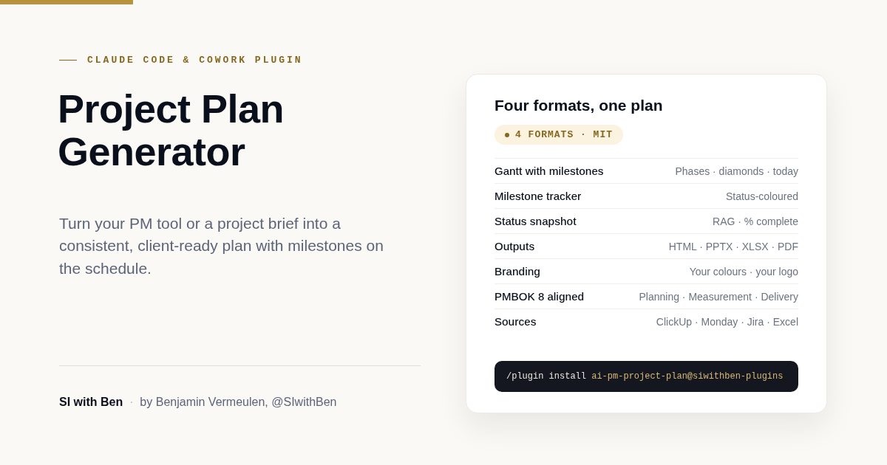

# Project Plan Generator: a Claude plugin by SI with Ben



I built this plugin so I could stop rebuilding the same Gantt chart, milestone tracker, and status deck by hand for every client. Point it at a brief, a Monday.com board, or a pasted task list, and it produces a premium-editorial, client-ready project plan package in four synchronised formats: Excel, interactive HTML, PowerPoint, and PDF.

By Benjamin Vermeulen, [@SIwithBen](https://www.youtube.com/@SIwithBen)

Watch the walkthrough: [Generate Consistent Project Plans, Risk Registers & More with This Simple Plugin for Claude](https://youtu.be/EM8iCCXgq9A)

More on the Substack: [benjaminvermeulen.substack.com](https://benjaminvermeulen.substack.com/)

---

## What it produces

Give the skill a structured project brief, or live data pulled via an MCP connector, and it generates four artefacts that tell the same story across PowerPoint, HTML, Excel, and PDF:

| Artefact                | PMBOK domain           | Excel sheet     | HTML section                 | PowerPoint slide             |
|--------------------------|------------------------|-----------------|------------------------------|------------------------------|
| Cover + project identity | Planning               | Overview hero   | Hero                         | Cover                        |
| Executive snapshot       | Measurement            | Overview cards  | Snapshot cards + status quote| Executive snapshot           |
| Timeline overview        | Planning, Delivery     | Gantt (top)     | SVG Gantt (phase rows)       | Timeline overview            |
| Detail Gantt             | Planning, Measurement  | Gantt (tasks)   | SVG Gantt (task rows)        | Detail Gantt                 |
| Milestone tracker        | Measurement            | Milestones      | Milestone timeline + cards   | Milestones                   |
| Next 14 days             | Delivery               | –               | –                             | Next fortnight               |
| Review needed (flags)    | Delivery               | Review needed   | Review needed (conditional)  | Review needed (conditional)  |
| Handover / closing       | –                       | –               | Footer                        | Handover                     |

All four formats share the same data source, so the numbers never drift between views. The PDF is a print render of the same HTML page, not a separate build, so it always matches.

Milestones render directly on every schedule, not just on their own tracker: status-coloured diamonds on the HTML SVG Gantt, the PPTX Timeline overview and Detail Gantt slides, and a dedicated block at the top of the Excel Gantt sheet.

---

## What's new in 1.1.0

- **PDF output.** `generate_pdf.py` renders the HTML page's print stylesheet to a print-quality PDF, A4 landscape by default (`--size`/`--orientation` flags support Letter and portrait). It tries WeasyPrint first, falls back to headless Chrome/Chromium, then to LibreOffice converting the PPTX deck if neither is available.
- **Compact pagination.** The print layout packs the hero, snapshot cards, and status quote onto page one, scales the full Gantt to fit one landscape page with every month visible and nothing clipped, then flows milestones and any review-needed flags after, without stranding a heading alone on a near-empty page.
- **Milestones on the schedule.** Every Gantt now draws milestones as status-coloured diamonds directly on the timeline, with collision-aware date labels, instead of only on the dedicated milestone tracker.
- **Dependency-free, responsive HTML.** No Google Fonts or other CDN by default, so the page renders identically offline and inside sandboxed preview panes. The layout is responsive from about 600px wide up to full desktop, with the Gantt and milestone timeline scrolling horizontally rather than compressing into illegible text.
- **A small test suite.** `tests/test_generators.py` generates all four formats from the sample plan and checks that milestones actually render as markers on each schedule.

---

## Install

### Claude Code

```bash
/plugin marketplace add benno-v/ai-pm-project-plan
/plugin install ai-pm-project-plan
```

### Claude Cowork

Go to **Customize > Plugins > Add marketplace**, and enter `benno-v/ai-pm-project-plan`. Then install the `ai-pm-project-plan` plugin from the marketplace.

Once installed, the `project-plan-generator` skill is available. Trigger it with something like:

> *"Generate a client-ready project plan from my Monday.com board."*
> *"Build a Gantt and milestone tracker for the Acme renovation."*
> *"Turn this project brief into a plan deck and workbook for the client, and give me a PDF too."*

---

## How it works

1. **You describe the project** from a brief, an MCP-connected tool, or a pasted task list.
2. **The skill builds a structured `plan` object**: project identity, brand, phases, tasks, milestones, and optional flags.
3. **It proposes the plan** and surfaces assumptions and review-needed flags before generating a single file.
4. **The requested generators run.** Default is all four: `generate_xlsx.py`, `generate_html.py`, `generate_pptx.py`, `generate_pdf.py`, all sharing one palette module, `brand.py`. If you ask for PDF specifically, it always runs `generate_pdf.py` rather than substituting another format.
5. **You get the files in your workspace folder.** Open the Excel for the full dataset, the HTML for a browser view, the PowerPoint for the client meeting, the PDF for printing or emailing.

Validation checkpoints run before generation: every task has a matching phase, milestones pass the three-test rule, at-risk milestones have matching flag entries, and nothing internal is marked client-visible.

---

## Always review

This plugin generates a plan; it doesn't replace your judgement as the project manager. Status values, progress fractions, and flag reasons need a human pass before anything ships to a client. Treat the output as a strong first draft, not a final artefact.

---

## Sample output

The `assets/sample-outputs/` folder contains a fully-generated sample for a fictional *Acme HQ Office Renovation* project:

- `sample-plan.json`, the structured `plan` object that drives generation
- `sample-project-plan.xlsx`, Excel workbook (Overview, Gantt, Milestones, Review needed)
- `sample-project-plan.html`, self-contained HTML, opens offline, no external dependencies
- `sample-project-plan.pptx`, 8-slide premium-editorial deck
- `sample-project-plan.pdf`, print-quality PDF (A4 landscape) of the same plan
- `acme-logo.png`, placeholder logo showing per-client branding

Open any of these files to see what the skill produces.

---

## Brand customisation

Everything is driven by two colours and an optional logo, specified in the plan JSON:

```json
"brand": {
  "primary":       "#0B2545",
  "accent":        "#C49A3A",
  "display_font":  "Georgia",
  "body_font":     "Calibri"
},
"project": {
  "logo_path": "acme-logo.png"
}
```

Only the two colours are needed. The rest of the palette, tints, shades, neutrals, status colours, is derived automatically by `scripts/brand.py`. Fonts are optional and format-specific: PPTX and XLSX default to Georgia and Calibri; HTML and PDF default to a system font stack with no webfont download, unless you set `brand.web_fonts: true` to opt into Fraunces and Inter via Google Fonts.

The logo is optional. If supplied, it appears in the PPTX footer on every slide, in the HTML hero and footer, and near cell F2 on the Excel Overview sheet. If no logo is supplied, the artefacts still render cleanly.

See `skills/project-plan-generator/references/brand-system.md` for the full derivation rules and per-format placement.

---

## Running the generators directly

Outside of Claude, you can run the generators against any plan JSON file. They live in `skills/project-plan-generator/scripts/`:

```bash
python skills/project-plan-generator/scripts/generate_xlsx.py --plan plan.json --out plan.xlsx
python skills/project-plan-generator/scripts/generate_html.py --plan plan.json --out plan.html
python skills/project-plan-generator/scripts/generate_pptx.py --plan plan.json --out plan.pptx
python skills/project-plan-generator/scripts/generate_pdf.py  --plan plan.json --out plan.pdf   # --size A4|Letter --orientation landscape|portrait
python skills/project-plan-generator/scripts/recalc.py plan.xlsx   # optional, bakes cached formula values
```

Dependencies:

```bash
pip install openpyxl python-pptx Pillow weasyprint
```

`weasyprint` is optional but recommended for PDF output. If it isn't installed, `generate_pdf.py` falls back to a Chrome or Chromium binary already on your PATH (`--print-to-pdf`), then to LibreOffice (`soffice --convert-to pdf`, which converts the PPTX deck instead, so the result is 16:9 rather than A4/Letter). It fails with a clear message if none of the three are available.

`recalc.py` additionally requires LibreOffice on your path. It's optional; Excel will recalculate formulas on first open.

A smoke-test suite lives in `tests/test_generators.py`. It generates all four formats from the sample plan and checks that milestones render as markers on the schedule in each:

```bash
python -m unittest discover -s tests
```

---

## PMBOK 8th Edition alignment

The skill anchors to three PMBOK 8 performance domains: Planning, Measurement, and Delivery. The other five, Stakeholders, Team, Development approach, Project work, Uncertainty, are intentionally out of scope here; they belong in separate artefacts (stakeholder register, resource plan, charter, internal tools, risk register).

The mapping and rationale are documented in `skills/project-plan-generator/references/pmbok-mapping.md`. This skill produces **client-facing plan artefacts**, not an all-in-one governance bundle.

---

## What the skill deliberately does not do

- **Work breakdown structure.** The plan groups tasks into phases, not a multi-level WBS. If you need a formal WBS with charge codes, use a different artefact.
- **RACI matrix.** Tasks carry an `owner_role`, not a full responsibility map.
- **Risk register.** Issues that need client action surface as `flags`; the internal risk register is managed elsewhere.
- **Cost management.** No budgets, earned value, or cost tracking.
- **Dependency arrows on the Gantt.** `depends_on` is captured in the data but not visualised yet.

Ask for one of these and the skill will flag the gap rather than fake the output.

---

## File structure

```
ai-pm-project-plan/
├── .claude-plugin/
│   └── marketplace.json               # Plugin registry entry
├── skills/
│   └── project-plan-generator/
│       ├── SKILL.md                   # Skill entry point
│       ├── references/
│       │   ├── gantt-layout.md        # Plan JSON schema + Gantt rules
│       │   ├── milestone-tracker.md   # Milestone conventions
│       │   ├── pmbok-mapping.md       # Three-domain mapping
│       │   ├── brand-system.md        # Palette + font + logo derivation
│       │   └── visual-design-principles.md  # Editorial design principles
│       └── scripts/
│           ├── brand.py               # Shared palette + logo module
│           ├── generate_html.py       # Self-contained, dependency-free HTML
│           ├── generate_pptx.py       # Shape-based PPTX
│           ├── generate_xlsx.py       # Editorial Excel
│           ├── generate_pdf.py        # Print-quality PDF (renders the HTML)
│           └── recalc.py              # Optional formula bake
├── assets/
│   └── sample-outputs/                # Acme renovation sample
│       ├── sample-plan.json
│       ├── sample-project-plan.html
│       ├── sample-project-plan.pptx
│       ├── sample-project-plan.xlsx
│       ├── sample-project-plan.pdf
│       └── acme-logo.png
├── tests/
│   └── test_generators.py             # Smoke tests for all four generators
├── CHANGELOG.md
├── LICENSE                            # MIT
└── README.md                          # This file
```

---

## Credits

By Benjamin Vermeulen, [@SIwithBen](https://www.youtube.com/@SIwithBen).

Part of the *AI for Project Managers* content ecosystem. If you find this useful, the full walkthrough is on YouTube, [Generate Consistent Project Plans, Risk Registers & More with This Simple Plugin for Claude](https://youtu.be/EM8iCCXgq9A), and on Substack at [benjaminvermeulen.substack.com](https://benjaminvermeulen.substack.com/).

Issues, suggestions, and pull requests welcome.

---

## License

MIT, see [LICENSE](./LICENSE).
